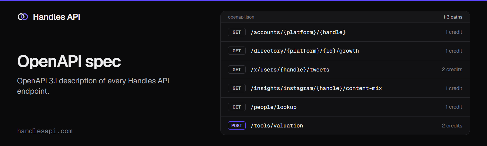
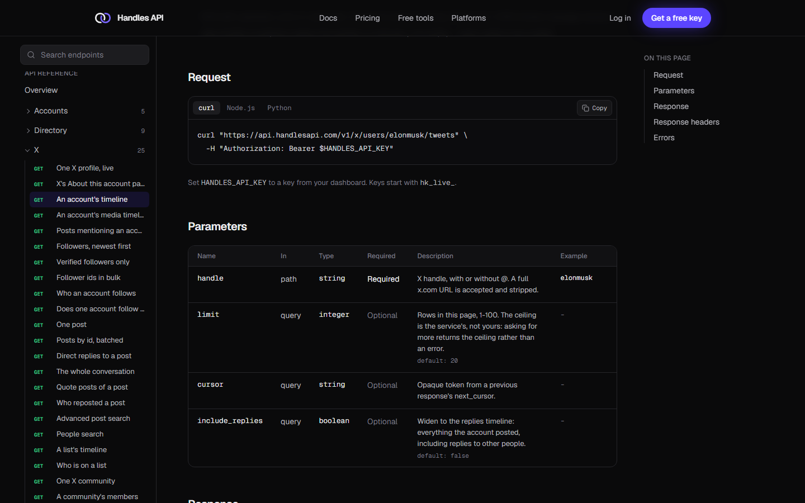

# Handles API OpenAPI specification

This repository holds the [OpenAPI 3.1](https://spec.openapis.org/oas/latest.html) description of the [Handles API](https://handlesapi.com), a REST and MCP API that returns public data from X (Twitter), Instagram, TikTok, YouTube, Telegram, Bluesky, Twitch, Kick and LinkedIn companies in one consistent JSON shape. The single file, [`openapi.json`](openapi.json), describes all 113 endpoints under `https://api.handlesapi.com/v1`, their parameters, response envelope, error codes and credit costs. It is the source the [TypeScript](https://github.com/handlesapi/handlesapi-js) and [Python](https://github.com/handlesapi/handlesapi-python) clients are generated from.

Live URL (always current, CORS enabled): `https://handlesapi.com/openapi.json`. This repository keeps a copy of the same file, also available raw at `https://raw.githubusercontent.com/handlesapi/openapi/main/openapi.json`.

## Why

- One file describes every endpoint, so any OpenAPI toolchain (code generators, API clients, mock servers, linters, AI agents) can use the API without hand-written wrappers.
- Credit cost, live-read behaviour and required scope are machine-readable on each operation as `x-credits`, `x-live-call` and `x-scope`.
- Every operation has a stable `operationId`, which the generated clients use as method names.

## Quickstart

Get a key at [handlesapi.com/signup](https://handlesapi.com/signup); the Free plan gives you 100 credits to try every endpoint, once, with no card. Authenticate with `Authorization: Bearer <key>` (or an `x-api-key` header).

```bash
export HANDLES_API_KEY=hk_live_...
curl https://api.handlesapi.com/v1/accounts/youtube/mrbeast \
  -H "Authorization: Bearer $HANDLES_API_KEY"
```

### Import into Postman or Insomnia

Both import OpenAPI 3.1 from a URL. In Postman choose Import, then paste `https://handlesapi.com/openapi.json`. In Insomnia choose Create, Import, From URL. Then set a bearer token (your key) on the collection or environment.

### Generate a client

```bash
# TypeScript types
npx openapi-typescript https://handlesapi.com/openapi.json -o handlesapi.d.ts

# Any language, with OpenAPI Generator
npx @openapitools/openapi-generator-cli generate \
  -i https://handlesapi.com/openapi.json \
  -g python -o ./handlesapi-client
```

The official clients already do this for you, with retries and credit headers handled: [handlesapi-js](https://github.com/handlesapi/handlesapi-js) and [handlesapi-python](https://github.com/handlesapi/handlesapi-python).

## Endpoints

Each operation in the spec is rendered as a page in the [API reference](https://handlesapi.com/docs/reference), with request examples, parameters, response and errors.



113 operations in 11 groups. Cost is credits per successful call; `live` means the data is read from the platform at request time rather than from the catalog. Full parameters and example responses: [API reference](https://handlesapi.com/docs/reference).

### Accounts (5)

Check whether a handle exists on a platform, one at a time or in bulk, with identity and audience.

| Method | Path | What it does | Credits |
| --- | --- | --- | --- |
| GET | `/accounts/platforms` | What a check can answer, per platform | 1 |
| GET | `/accounts/{platform}/{handle}` | Check one account against our catalog | 1 |
| GET | `/accounts/{platform}/{handle}/live` | Check one account live, at the source | 2 (live) |
| POST | `/accounts/check` | Check up to 50 accounts at once | 1 |
| GET | `/accounts/resolve` | Find one handle on every platform at once | 1 |

### Directory (9)

Browse and search each platform's catalog with filters, sorting and cursors.

| Method | Path | What it does | Credits |
| --- | --- | --- | --- |
| GET | `/directory` | Catalog capability map | 1 |
| GET | `/directory/{platform}` | List and filter a catalog | 1 |
| GET | `/directory/{platform}/{id}` | One account or channel | 1 |
| GET | `/directory/{platform}/{id}/growth` | Daily audience history | 1 |
| GET | `/directory/{platform}/{id}/followers` | Inbound graph edges | 1 |
| GET | `/directory/{platform}/{id}/following` | Outbound graph edges | 1 |
| POST | `/directory/{platform}/bulk` | Resolve up to 100 records at once | 1 |
| GET | `/directory/{platform}/facets` | Distribution of the catalog | 1 |
| GET | `/directory/search` | Search every platform at once | 1 |

### X (25)

Live X reads: profiles, timelines, search, followers and more.

| Method | Path | What it does | Credits |
| --- | --- | --- | --- |
| GET | `/x/users/{handle}` | One X profile, live | 2 (live) |
| GET | `/x/users/{handle}/about` | X's About this account panel | 2 (live) |
| GET | `/x/users/{handle}/tweets` | An account's timeline | 2 (live) |
| GET | `/x/users/{handle}/media` | An account's media timeline | 2 (live) |
| GET | `/x/users/{handle}/mentions` | Posts mentioning an account | 2 (live) |
| GET | `/x/users/{handle}/followers` | Followers, newest first | 2 (live) |
| GET | `/x/users/{handle}/verified-followers` | Verified followers only | 2 (live) |
| GET | `/x/users/{handle}/followers/ids` | Follower ids in bulk | 2 (live) |
| GET | `/x/users/{handle}/following` | Who an account follows | 2 (live) |
| GET | `/x/users/{handle}/relationship` | Does one account follow another | 2 (live) |
| GET | `/x/tweets/{id}` | One post | 2 (live) |
| GET | `/x/tweets` | Posts by id, batched | 2 (live) |
| GET | `/x/tweets/{id}/replies` | Direct replies to a post | 2 (live) |
| GET | `/x/tweets/{id}/thread` | The whole conversation | 2 (live) |
| GET | `/x/tweets/{id}/quotes` | Quote posts of a post | 2 (live) |
| GET | `/x/tweets/{id}/retweeters` | Who reposted a post | 2 (live) |
| GET | `/x/search/tweets` | Advanced post search | 2 (live) |
| GET | `/x/search/users` | People search | 2 (live) |
| GET | `/x/lists/{id}/tweets` | A list's timeline | 2 (live) |
| GET | `/x/lists/{id}/members` | Who is on a list | 2 (live) |
| GET | `/x/communities/{id}` | One X community | 2 (live) |
| GET | `/x/communities/{id}/members` | A community's members | 2 (live) |
| GET | `/x/communities/{id}/moderators` | A community's moderators | 2 (live) |
| GET | `/x/communities/{id}/tweets` | A community's posts | 2 (live) |
| GET | `/x/trends` | What is trending, by location | 2 (live) |

### People (2)

Find one person across platforms, or find accounts by audience and category.

| Method | Path | What it does | Credits |
| --- | --- | --- | --- |
| GET | `/people/lookup` | Find one handle across every catalog | 1 |
| GET | `/people/search` | Find accounts matching audience and engagement criteria | 1 |

### Live scrape (3)

Live reads for platforms outside the X group.

| Method | Path | What it does | Credits |
| --- | --- | --- | --- |
| GET | `/scrape/x/user` | Live X profile | 2 (live) |
| POST | `/scrape/x/users` | Live X profiles, batched | 2 (live) |
| GET | `/scrape/telegram/channel` | Live Telegram channel read | 2 (live) |

### Insights (31)

Measured dossiers per platform: top posts, content mix, engagement, benchmarks.

| Method | Path | What it does | Credits |
| --- | --- | --- | --- |
| GET | `/insights/x/{handle}` | Complete intelligence dossier for one X account | 1 |
| GET | `/insights/x/{handle}/engagement` | Engagement metrics for one X account | 1 |
| GET | `/insights/x/{handle}/top-tweets` | The account's permanently kept best posts | 1 |
| GET | `/insights/x/{handle}/viral-patterns` | What makes this account's posts perform | 1 |
| GET | `/insights/x/{handle}/benchmark` | This account against its follower cohort | 1 |
| GET | `/insights/x/leaders` | Accounts ranked by how well they engage | 1 |
| GET | `/insights/x/coverage` | How much of the catalog has tweet-level coverage | 1 |
| POST | `/insights/x/compare` | Side-by-side metrics for up to ten accounts | 1 |
| GET | `/insights/instagram/{handle}/top-posts` | An account's best performing posts | 1 |
| GET | `/insights/instagram/{handle}/content-mix` | Which post format actually works on this account | 1 |
| GET | `/insights/instagram/{handle}/cadence` | How often an account posts, and whether it has gone quiet | 1 |
| GET | `/insights/instagram/benchmarks` | Measured engagement rates by follower band | 1 |
| GET | `/insights/instagram/{handle}/coverage` | What we hold on a handle, before you pay for a lookup | 1 |
| GET | `/insights/tiktok/{handle}/growth` | Follower, like and posting velocity from the snapshot series | 1 |
| GET | `/insights/tiktok/benchmarks` | Measured likes per video by follower band | 1 |
| GET | `/insights/tiktok/{handle}/coverage` | What we hold on a handle, before you pay for a lookup | 1 |
| GET | `/insights/telegram/{username}/audience-quality` | Whether a channel's subscribers and its post views moved together | 1 |
| GET | `/insights/telegram/{username}/name-history` | Every username a channel has held, and which ones it gave up | 1 |
| GET | `/insights/youtube/{handle}/benchmark` | A channel's view velocity, ranked against channels its own size | 1 |
| GET | `/insights/youtube/view-velocity-bands` | The view-velocity ladders every YouTube benchmark is read against | 1 |
| GET | `/insights/bluesky/{handle}/posting-impact` | What an account gains on the days it posts against the days it does not | 1 |
| GET | `/insights/instagram/{handle}` | Measured Instagram engagement, placed against its cohort | 1 |
| GET | `/insights/telegram/{username}/reach` | How many subscribers actually see a Telegram post | 1 |
| GET | `/insights/telegram/reach-bands` | The reach percentile ladders every Telegram score is read against | 1 |
| GET | `/insights/youtube/{handle}/activity` | Daily views earned by one account | 1 |
| GET | `/insights/tiktok/{handle}/activity` | Daily likes earned by one account | 1 |
| GET | `/insights/bluesky/{handle}/activity` | Daily posts earned by one account | 1 |
| GET | `/insights/telegram/{username}/activity` | How a channel's per-post reach has moved, day by day | 1 |
| GET | `/insights/telegram/{username}/growth-quality` | The shape of a channel's subscriber growth | 1 |
| GET | `/insights/bluesky/{handle}/growth-quality` | The shape of an account's follower growth | 1 |
| GET | `/insights/activity/platforms` | What each platform measures, how precise it is, and how deep | 1 |

### Trends (2)

Who gained or lost the most audience on the freshest day.

| Method | Path | What it does | Credits |
| --- | --- | --- | --- |
| GET | `/trends/{platform}/movers` | Biggest audience gains and losses for a day | 1 |
| GET | `/trends/platforms` | Which platforms can be ranked, and how fresh each is | 1 |

### Identity (5)

Resolve a company or person to its accounts across networks.

| Method | Path | What it does | Credits |
| --- | --- | --- | --- |
| GET | `/identity/graph` | One organisation's accounts across every network, from any one of them | 1 |
| POST | `/identity/graph/bulk` | Resolve up to 100 handles to their companies in one call | 1 |
| GET | `/identity/company/{slug}` | Every social account a company publishes | 1 |
| GET | `/identity/resolve` | Which company publishes this handle | 1 |
| GET | `/identity/telegram/{username}/aliases` | Every username a Telegram channel holds | 1 |

### Graph (4)

Relationships between accounts.

| Method | Path | What it does | Credits |
| --- | --- | --- | --- |
| GET | `/graph/x/overlap` | Audience overlap between two X accounts | 1 |
| GET | `/graph/x/{handle}/similar` | Lookalike X accounts by shared audience | 1 |
| GET | `/graph/x/{handle}/notable-followers` | Followers of an X account ranked by their own influence | 1 |
| GET | `/graph/x/{handle}` | Follow-graph coverage for one X account | 1 |

### Tools (22)

Ready-made calculators: valuation, engagement, audits, posting times.

| Method | Path | What it does | Credits |
| --- | --- | --- | --- |
| GET | `/tools` | List every analysis tool | 1 |
| POST | `/tools/valuation` | Value an X account | 2 (live) |
| POST | `/tools/shadowban-check` | Check an X account for visibility filtering | 2 (live) |
| POST | `/tools/follower-audit` | Audit an X account's followers for fakes | 2 (live) |
| POST | `/tools/engagement-calculator` | Measure an X account's engagement rate | 2 (live) |
| POST | `/tools/best-posting-time` | Find when an X account should post | 2 (live) |
| POST | `/tools/algorithm-score` | Score an X account against the ranking signals | 2 (live) |
| POST | `/tools/tweet-analyzer` | Analyze a single X post | 2 (live) |
| POST | `/tools/mention-checker` | See who is mentioning an X account | 2 (live) |
| POST | `/tools/growth-simulator` | Project how long a follower target takes | 1 |
| GET | `/tools/profile-pic` | Fetch an X profile picture URL | 2 (live) |
| GET | `/tools/audience-finder` | Search the Telegram, TikTok and X catalog | 1 |
| POST | `/tools/tiktok/engagement` | Measure a TikTok account's engagement | 2 (live) |
| POST | `/tools/tiktok/money` | Estimate TikTok brand-deal earnings | 2 (live) |
| POST | `/tools/youtube/money` | Estimate YouTube ad earnings | 2 (live) |
| POST | `/tools/youtube/channel-value` | Estimate what a YouTube channel is worth | 2 (live) |
| POST | `/tools/kick/money` | Estimate Kick streamer earnings | 2 (live) |
| POST | `/tools/kick/channel-value` | Estimate what a Kick channel is worth | 2 (live) |
| POST | `/tools/kick/rank` | Rank a Kick channel by followers and viewership | 2 (live) |
| POST | `/tools/twitch/money` | Estimate Twitch streamer earnings | 2 (live) |
| POST | `/tools/twitch/channel-value` | Estimate what a Twitch channel is worth | 2 (live) |
| POST | `/tools/twitch/rank` | Rank a Twitch channel by followers and viewership | 2 (live) |

### Leads (5)

LinkedIn companies with socials, contacts and decision makers.

| Method | Path | What it does | Credits |
| --- | --- | --- | --- |
| GET | `/leads/linkedin/domains/{domain}` | Enrich a company from its website domain | 1 |
| GET | `/leads/linkedin/segments` | Firmographic market sizing with real counts | 1 |
| GET | `/leads/linkedin/companies` | LinkedIn company records, filterable | 1 |
| GET | `/leads/linkedin/companies/{id}` | One company with socials, contacts and decision makers | 1 |
| GET | `/leads/linkedin/people` | Named people and decision makers | 1 |

## Pricing and credits

Catalog, insight, identity and lead reads cost 1 credit; live reads cost 2. Plans: Free (100 credits, once), Starter ($29, 15,000 credits a month), Pro ($99, 75,000), Business ($299, 300,000), Scale ($799, 1,200,000). Every response carries `X-Credits-Cost`, `X-Credits-Remaining` and `X-Credits-Period-End`. See [Credits and limits](https://handlesapi.com/docs/credits-and-limits) and [pricing](https://handlesapi.com/pricing).

## Responses and errors

Successful calls return `{ "data": ..., "meta": { "request_id": ..., "took_ms": ... } }`; list calls add `meta.page.next_cursor`, which is `null` on the last page. Failures return `{ "error": { "code", "message", "request_id", "details" } }` with one of 13 stable codes; branch on `code`, not on the message. See [Errors](https://handlesapi.com/docs/errors) and [Pagination](https://handlesapi.com/docs/pagination).

## MCP

The same API is available to AI assistants as a remote MCP server at `https://api.handlesapi.com/mcp`. See [handlesapi/mcp](https://github.com/handlesapi/mcp) for Claude, Cursor and VS Code setup, and [the MCP docs](https://handlesapi.com/docs/mcp).

## Links

- Website: [handlesapi.com](https://handlesapi.com)
- Documentation: [handlesapi.com/docs](https://handlesapi.com/docs)
- API reference: [handlesapi.com/docs/reference](https://handlesapi.com/docs/reference)
- Authentication: [handlesapi.com/docs/authentication](https://handlesapi.com/docs/authentication)
- Pricing: [handlesapi.com/pricing](https://handlesapi.com/pricing)
- TypeScript client: [handlesapi-js](https://github.com/handlesapi/handlesapi-js)
- Python client: [handlesapi-python](https://github.com/handlesapi/handlesapi-python)
- Examples: [handlesapi/examples](https://github.com/handlesapi/examples)
- MCP server: [handlesapi/mcp](https://github.com/handlesapi/mcp)

The specification file is kept in sync with the one served at handlesapi.com/openapi.json. Handles API is an independent service and is not affiliated with any of the platforms it covers. It returns public data only. MIT licensed.
